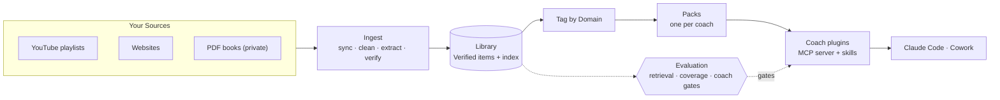

# Agentic Coach Builder

[](https://github.com/kaushalag29/Agentic-Coach-Builder/actions/workflows/ci.yml)


**Agentic Coach Builder turns the YouTube talks, websites and PDF books you choose into your own AI coach for
Claude Code and Cowork.** Every answer cites the exact second of a talk, the paragraph of an article or the page
of a book. The coach remembers your context on your machine, and an evaluation framework measures retrieval and
answers before a coach ships. No fine-tuning and no training: change the Sources and rebuild.

- **Any subject, your Sources:** YouTube playlists (captions only), any website (a polite crawler), PDF books you own
  (kept private).
- **Verified knowledge only:** an LLM extracts advice and quotes; code locates every quote in the source before it
  can be cited.
- **One engine, many coaches:** a coach is a Pack, a configuration file plus skills. Three ship as examples: a
  startup **founder coach**, a software **coding coach** and a long-term **investor coach**.
- **Local-first:** search and memory run in a small MCP server on your computer; your conversations and memory stay
  there.
- **Measured:** a retrieval benchmark, coverage-honesty checks and coach gates on the real host decide when a build
  is good enough.

## How it works



Zoom in: [pipeline data flow](docs/architecture.md#pipeline-data-flow) ·
[how a coach answers](docs/architecture.md#how-a-coach-answers) ·
[Domain tagging](docs/architecture.md#domain-tagging) ·
[evaluation framework](docs/architecture.md#evaluation-framework)

## Quickstart

```bash
git clone https://github.com/kaushalag29/Agentic-Coach-Builder.git && cd Agentic-Coach-Builder
uv venv --python 3.12 && source .venv/bin/activate
uv pip install -e ".[extract,index,serve,eval,pack,dev,pot,web,pdf]"
cp sources.example.yaml sources.yaml && cp .env.example .env   # your Sources and your LLM endpoint
ytbrain ops                                                    # ingest -> tag -> evaluate -> build the coach plugins
claude --plugin-dir dist/plugin                                # then, in Claude Code: /founder-coach:setup
```

Step by step, with every LLM backend and the Cowork install: [docs/getting-started.md](docs/getting-started.md).
To make a coach of your own: [docs/build-your-own-coach.md](docs/build-your-own-coach.md).

## Requirements

| | |
|---|---|
| **OS** | macOS (tested on Apple silicon) or Linux (test suites run on Ubuntu in CI); Windows untested |
| **Phones** | Not supported: a coach is a local server that Claude starts on your computer, which the iOS and Android apps can't run |
| **Tools** | Python 3.11+, [uv](https://docs.astral.sh/uv/), git, [Deno](https://deno.com) for yt-dlp |
| **LLM** | [Ollama](https://ollama.com) by default, or any OpenAI-compatible endpoint: [LM Studio](https://lmstudio.ai), vLLM, llama.cpp, [OpenRouter](https://openrouter.ai) |
| **Host** | [Claude Code](https://code.claude.com/docs/en/setup) or Cowork on desktop, with a paid Claude plan |
| **Disk** | About 5 GB of local models for the index, plus your Library |

## Pipeline phases and commands

| Phase | Command | Writes | Needs |
|---|---|---|---|
| Configure | edit `sources.yaml`, `domains.yaml`, `.env` | | |
| Fetch | `ytbrain sync` | `data/raw/`, `data/books/` | network |
| Clean | `ytbrain clean` | `data/transcripts/` | |
| Extract | `ytbrain extract` | `data/metadata/` | LLM |
| Verify | `ytbrain verify` | `data/pages/` | |
| Index | `ytbrain index` | `data/lancedb/` | local models |
| Tag Domains | `ytbrain tag` | `data/tags/tags.db` | LLM for close calls |
| Enrich | `ytbrain enrich` | Rules and Facts in records | LLM |
| Evaluate retrieval | `ytbrain eval build\|run\|judge` | `data/eval/` | LLM judges |
| Knowledge pack | `ytbrain pack build --for <id>` | `data/pack/`, `data/packs/<id>/` | local ONNX models |
| Plugin | `python scripts/assemble_plugin.py --for <id> --pack <pack> --check --zip` | `dist/` | |
| Coach gates | `ytbrain eval coach` | `data/eval/coach/` | Claude Code, your plan |
| **All of it** | **`ytbrain ops`** | resumable, runs only what changed | |

Every Step is checkpointed per Document: stop anything with Ctrl+C and run it again. Reference:
[docs/commands.md](docs/commands.md) · [docs/pipeline.md](docs/pipeline.md) · [docs/ops.md](docs/ops.md).

## Evaluation

- **Retrieval:** Tuning questions generated from your Documents, labelled by two judges and a tie-breaker from other
  model families; nDCG@10, recall and MRR with 95% intervals, and a regression gate. The released benchmark in
  [`eval/`](eval/) ships ids, titles, links, timestamps and grades, never transcript text ([docs/eval-spec.md](docs/eval-spec.md)).
- **Coverage honesty:** `ytbrain eval gap` measures how often a coach answers a question its Library doesn't cover,
  or refuses one it does.
- **Coach gates on the real host:** Citations supported (G2), pushback on weak plans (G4), memory across weeks
  (G5), every part of a multi-part question (G6), Projects kept apart (G7), no security picks (G8).
- **Experiments:** [can a small local classifier replace the tagging LLM?](docs/experiments/laya-tagging-tiebreak.md)
  A blind three-judge panel, no hand labels, decision rules fixed in advance. It couldn't (−13.9 points), and the
  study found where tagging really loses accuracy.

## FAQ

**Is this fine-tuning?** No. Nothing is trained. The coach is a Claude session grounded in your Sources through
search over Verified quotes, so it updates the day your Sources change and every claim can be checked.

**How is it different from plain RAG?** Only quotes found verbatim in the source are indexed; every hit carries a
deep link; each search reports `coverage` so the coach names what it doesn't know; memory of your goals and decisions
persists per Project; and quality is gated by evals, not eyeballed.

**Can I run it with local models only?** Yes for ingestion, tagging and the coaches: Ollama is the default, and
LM Studio works through the OpenAI-compatible backend. The eval judges need an OpenAI-compatible endpoint that serves
models from different families (two judges and a tie-breaker).

**Does my data leave my machine?** Coach memory and the usage log are stored only on your machine; Claude sees what
the coach returns in a conversation, as with any tool. Ingestion sends Source text to the LLM endpoint you configure.

**Are my books shared?** No. PDF books are a private Source: indexed for your own coach, excluded from release
builds, never seeded into the released benchmark ([ADR-0014](docs/adr/0014-books-are-private-chapters-parsed-with-docling.md)).

**What does it cost?** Extracting about 700 YC talks with `deepseek/deepseek-v4-flash` on OpenRouter cost
$0.40–0.80; a local model costs nothing but time ([tested setup](docs/getting-started.md#tested-setup)).

**Does it work on my phone?** No: Claude's mobile apps can't run local plugins.

## Documentation

| Doc | What's in it |
|---|---|
| [Getting started](docs/getting-started.md) | Requirements, install, LLM backends, first coach, installing it in Claude |
| [Build your own coach](docs/build-your-own-coach.md) | Sources, Domains, a Pack, skills and eval cases for a new coach |
| [Architecture](docs/architecture.md) | Diagrams, project layout, design decisions |
| [Configuration](docs/configuration.md) | `sources.yaml`, Domains and tagging, every environment variable |
| [Pipeline](docs/pipeline.md) · [ops](docs/ops.md) · [commands](docs/commands.md) | Each Step, the one-command loop, every command |
| [Coaches](docs/coaches.md) | Knowledge packs, plugins, the runtime and its MCP tools |
| [Evaluation spec](docs/eval-spec.md) · [Testing](docs/testing.md) | The benchmark; testing the whole system end to end |
| [Troubleshooting](docs/troubleshooting.md) · [Usage log](docs/usage-log.md) | Fixes; what the local usage log records |
| [ADRs](docs/adr/) · [Glossary](CONTEXT.md) · [AGENTS.md](AGENTS.md) | Decisions, vocabulary, instructions for coding agents |

## Contributing

Issues and pull requests are welcome: see [CONTRIBUTING.md](CONTRIBUTING.md). The offline test suites need no keys,
models or network.

## Security and privacy

Secrets live only in `.env` (git-ignored), and CI scans every tracked file for keys. Coach memory, its backups and the
usage log stay on your machine. See [SECURITY.md](SECURITY.md).

## License

**Source-available** under the [Business Source License 1.1](LICENSE), converting to **Apache 2.0 on 2030-01-01**.
Free for personal use, education, research, open-source projects, and a person or company coaching itself and its
own team. Offering it, or a coach or knowledge base built with it, to others commercially needs a license: ask through
this repository.

## Disclaimer

Coaches summarise the Sources you give them. Their output is educational and may be wrong, outdated or out of context;
it is not legal, financial, investment or tax advice. You are responsible for your right to download and process what
you ingest, and for following the terms of YouTube, websites and your LLM provider. Provided "as is".
