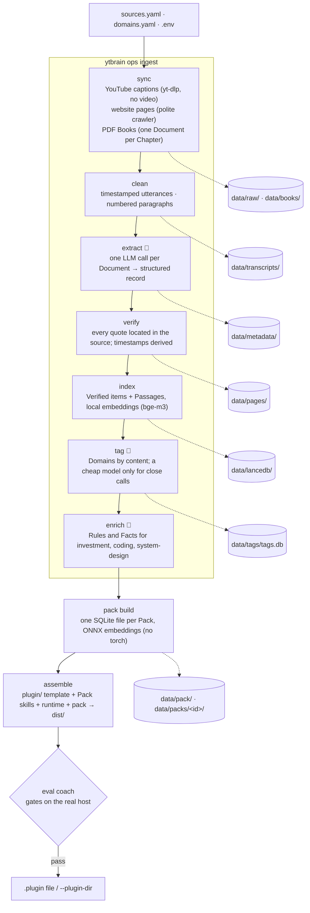
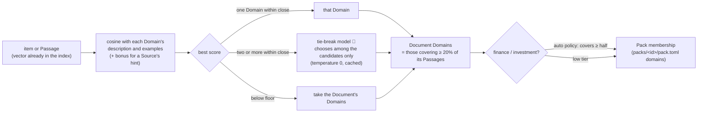
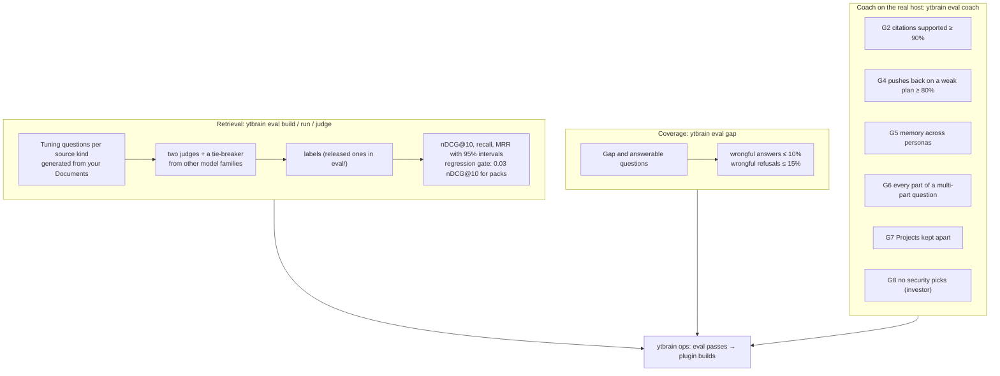

# Architecture

Agentic Coach Builder has two halves:

- **`ytbrain/`**, the build side: turns your Sources into Verified, citable knowledge, tags it by Domain,
  measures retrieval and answers, and assembles one plugin per coach.
- **`founder_coach/`**, the runtime a coach ships with: a small MCP server that searches its Knowledge pack
  and remembers the person it coaches. It never imports `ytbrain`, PyTorch, LanceDB or yt-dlp
  ([ADR-0010](adr/0010-one-light-runtime-for-every-host.md)); `ytbrain` reuses its search code, so the index and
  the pack rank identically.

The host model (Claude) writes every answer; the server only retrieves and remembers
([ADR-0002](adr/0002-mcp-server-retrieves-host-agent-generates.md)).

- [Pipeline data flow](#pipeline-data-flow)
- [How a coach answers](#how-a-coach-answers)
- [Domain tagging](#domain-tagging)
- [Evaluation framework](#evaluation-framework)
- [Project layout](#project-layout)
- [Design decisions](#design-decisions)

## Pipeline data flow

Every Step is checkpointed per Document in `data/manifest.db`, so any one can be stopped and re-run alone.
`ytbrain ops ingest` runs them in this order, then `verify` and `index` once more for what `enrich` added
([ops.md](ops.md)).



🤖 marks the Steps that call an LLM. Everything else is local and deterministic. The model never writes
a timestamp or a citation: it quotes, and `verify` finds the quote in the transcript, paragraph or page and
derives the position. Only Verified items reach the index
([ADR-0004](adr/0004-only-verified-knowledge-reaches-the-coach.md)).

## How a coach answers

```mermaid
sequenceDiagram
    actor P as Person
    participant H as Claude (Code or Cowork)
    participant S as Coach MCP server<br/>(founder_coach, local)
    participant K as Knowledge pack<br/>knowledge.sqlite
    participant M as Project memory<br/>founder.db · FOUNDER.md

    P->>H: a question or a plan
    H->>S: coach_get_context
    S->>M: profile, Goals, Decisions, what's due
    S-->>H: context
    loop Search rounds (at most 5 rounds, 12 searches)
        H->>S: coach_search(part of the question)
        S->>K: dense (ONNX) top 50 + full-text (FTS5) top 50
        K-->>S: candidates
        S->>S: reciprocal-rank fusion → Stage, kind and recency boosts → diversity
        S-->>H: 10 hits with quotes, deep links, coverage (strong / partial / none)
    end
    H-->>P: answer with Citations, Gaps named
    opt the person says yes to saving
        H->>S: coach_record / coach_update
        S->>M: write + change log; FOUNDER.md regenerated
    end
```

- **Search covers the whole Library by default.** `coach_search` accepts `domains`, but the skills leave it out
  unless the person restricts the search: offline, even a perfectly chosen Domain filter lowered nDCG@10
  (`ytbrain eval run --config pack-oracle-domains --compare pack-no-rerank`).
- **Coverage is honest by design.** `strong` answers with Citations, `partial` answers what is covered and names
  the rest, `none` states a Gap. Thresholds follow each Domain's risk tier; `ytbrain eval gap` measures how often a
  coach wrongly answers a Gap or refuses an answerable question.
- **Memory is local and per Project** (one per company, system or goal), in `~/.ytbrain/<pack>/projects/<id>/`.
  Every write needs the person's yes and is logged
  ([ADR-0011](adr/0011-founder-store-keeps-a-change-log-and-writes-only-on-confirmation.md),
  [ADR-0016](adr/0016-a-plugin-per-pack-with-projects-and-a-common-profile.md)).
- **Quoted source text is data, never instructions**: it reaches the host wrapped as untrusted reference material.

## Domain tagging

Domains decide which coach's Pack an item ships in
([ADR-0017](adr/0017-domains-are-inferred-against-a-controlled-domain-list.md)).



High-tier Domains are applied from content only when they cover at least half of a Document's tagged Passages,
and at least two of them (`YTBRAIN_TAG_AUTO_SHARE`), or when you confirm them (`ytbrain domains review`). A
[documented experiment](experiments/laya-tagging-tiebreak.md) compared the tie-break model with a local
classifier and with no model at all.

## Evaluation framework



- Each coach gate runs your built plugin through the local `claude` CLI (Haiku by default, on your Claude plan),
  is cached on everything it reads and how it is graded; a failed pass/fail case (G4–G7) is decided by a majority
  of three runs.
- `ytbrain eval choice` checks that, with every coach installed together, each prompt reaches the right one.
- The released benchmark in `eval/` ships ids, titles, links, timestamps and grades, never transcript text
  ([eval-spec.md](eval-spec.md)).

## Project layout

```
ytbrain/                 the build side
  cli.py                 every command (`ytbrain --help`)
  sources.py, web/,      Source adapters: YouTube, websites, PDF Books (ADR-0013, ADR-0014)
  books/, fetch.py
  captions.py, verify.py transcripts and quote grounding
  extract/               schema, prompts, versions, LLM backends with retries
  knowledge/, index.py   Knowledge items, embeddings, the LanceDB index
  tagging.py, domains.py Domains: the controlled list and content tagging
  pack.py, packs.py      Knowledge packs and the per-coach Pack definitions
  eval/                  benchmark, judges, metrics, coverage, coach gates
  ops.py                 `ytbrain ops`: plans, checkpoints, change detection
  gaps.py                `ytbrain gaps`: what the coaches couldn't answer, from local usage logs
founder_coach/           the runtime every coach plugin runs (MCP server, search, memory)
plugin/                  the shared plugin template: manifest, MCP config, hook, skills, evals
packs/<id>/              one coach each: pack.toml (Domains, memory, profile, wording) and its own skills
domains.yaml             the Library's Domains: description, examples, risk tier, freshness, web policy
eval/                    the released retrieval benchmark (no transcript text)
experiments/             reproducible one-off studies, outside the pipeline
scripts/, ops/           plugin assembler, release, checks; ops wrappers and the launchd job
tests/                   offline suites; golden/ pins the MCP tool schemas
```

## Design decisions

The full record is in [adr/](adr/). The ones that shape everything:

- **Captions only, never video or audio.** One caption track per talk: a human English track, else YouTube's
  `en-orig` recognition.
- **The model quotes, the code locates.** Timestamps, paragraph numbers and pages come from `verify`, so one
  LLM call per Document is safe and every Citation opens at the quoted words.
- **Checkpoints per Step.** A new extraction prompt re-runs `extract` onward and nothing else; a new verifier
  re-runs only `verify`. Extraction releases are versioned, and older compatible records are kept
  ([ADR-0018](adr/0018-extraction-is-versioned-per-prompt-and-old-records-stay-compatible.md)).
- **Stage ranks, it never filters** ([ADR-0005](adr/0005-stage-is-a-ranking-signal-not-a-filter.md)).
- **One engine, many Packs over one Library** ([ADR-0015](adr/0015-one-engine-many-packs-over-one-library.md)):
  a new coach is a Pack definition, not a new codebase.
- **Books stay private** ([ADR-0014](adr/0014-books-are-private-chapters-parsed-with-docling.md)): indexed for your
  own coach, never shipped in a public pack, never seeded into the released benchmark.
