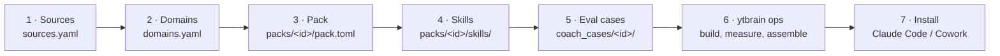

# Build your own coach

A coach is defined by **what it knows** (your Sources, tagged into Domains) and **how it coaches** (a Pack). The
pipeline, search, memory, plugin packaging and evaluation are shared, so a new coach needs configuration, not code.
The three coaches in `packs/` (founder, coding, investor) are working examples to copy.



Today these steps are manual, about a day of work for a new subject. A generator that drafts steps 2–5 from your
Sources and a short description, with a review at each step, is planned.

## 1. Add the Sources

List the playlists, websites and PDF folders the coach should learn from in `sources.yaml`
([configuration.md](configuration.md#sources-sourcesyaml)). Books stay private: they reach only builds marked
`private`, never a public pack.

## 2. Declare its Domains

A Domain is a subject with a description, example questions and a risk tier. Content is tagged against the list,
so a Source needs no label:

```bash
ytbrain domains add legal --risk high --description "Law for founders: incorporation, contracts, IP, employment"
ytbrain domains alias legal "law"
ytbrain domains propose           # groups content no Domain fits into proposed Domains (nothing is added)
```

Write the description and examples the way a person would ask: they are what content is scored against. The risk
tier decides how strong the evidence must be before the coach answers (`high`: below `strong` coverage it declines).

## 3. Write the Pack

Copy the closest example to `packs/<id>/pack.toml` and edit it. Every key is checked when the Pack loads.

| Section | What it sets |
|---|---|
| `[pack]` | `id`; `domains` it answers from; memory `modules` (from `goals`, `commitments`, `checkins`, `decisions`, `holdings`); `common_fields` it shares across coaches; `required` setup fields; `skills` and `prompts`; `builds` (`private`, `release`) |
| `[product]` | the plugin's `id`, `display_name`, `description` and `keywords` |
| `[words]` | what the person and a Project are called (`Engineer`, `system`) |
| `[runtime]` | the coach's name, its setup nudge and its coaching contract (`instructions`) |
| `[runtime.replace]` | the shared runtime's wording, rewritten for this coach |
| `[[profile]]` | each fact a Project remembers, with its description |

## 4. Add or adapt skills

Shared skills live in `plugin/skills/` (`ask`, `coach`, `setup`, `project`, `status`, `export`, `forget`,
`feedback`, …). A Pack's own `packs/<id>/skills/<name>/SKILL.md` replaces a shared one or adds a new one, like the
coding coach's `design-review` and `decision-record`.

## 5. Add evaluation cases

The gates run your built plugin on the real host ([architecture.md](architecture.md#evaluation-framework)):

- **G2** (Citations supported) works with no extra files: it asks Tuning questions seeded from the Documents in this
  coach's pack.
- **G4–G8** read `ytbrain/eval/coach_cases/<id>/`: `sycophancy.jsonl` (weak plans to push back on),
  `personas.jsonl` (multi-week memory), `decomposition.jsonl` (multi-part questions), `projects.jsonl` (Projects kept
  apart) and `safety.jsonl` (what it must refuse). A gate with no file has no cases; copy the coding or investor files
  as a start.
- Each gate's grading rubric comes from `PACK_RUBRICS` in `ytbrain/eval/coach.py` when the Pack has one, else the
  founder wording; a coach on a different subject should add its own.

## 6. Build and measure

```bash
ytbrain ops                                   # ingest, tag against the new Domains, eval, assemble every Pack
ytbrain ops plugin --coach                    # before you rely on it: the coach gates whose inputs changed
ytbrain gaps --pack <id> --days 30            # later: what the coach couldn't answer, from its local usage log
```

Or one Pack by hand:

```bash
ytbrain pack build --for <id> --include-private --out data/packs/<id>/pack-private
python scripts/assemble_plugin.py --for <id> --pack data/packs/<id>/pack-private --check --zip
ytbrain eval coach --plugin dist/<product-id>
```

## 7. Install it

`claude --plugin-dir dist/<product-id>` in Claude Code, or upload the `.plugin` file in Cowork
([getting-started.md](getting-started.md#install-your-coach-in-claude)). With several coaches installed,
`ytbrain eval choice` checks that each prompt reaches the right one.
